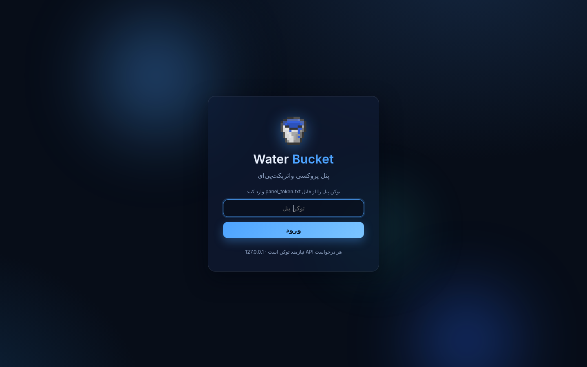
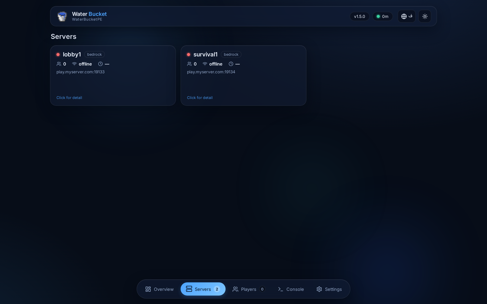
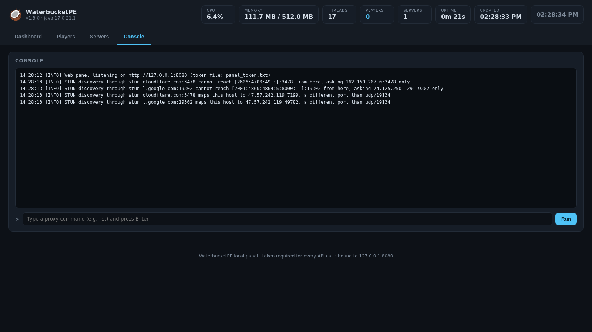
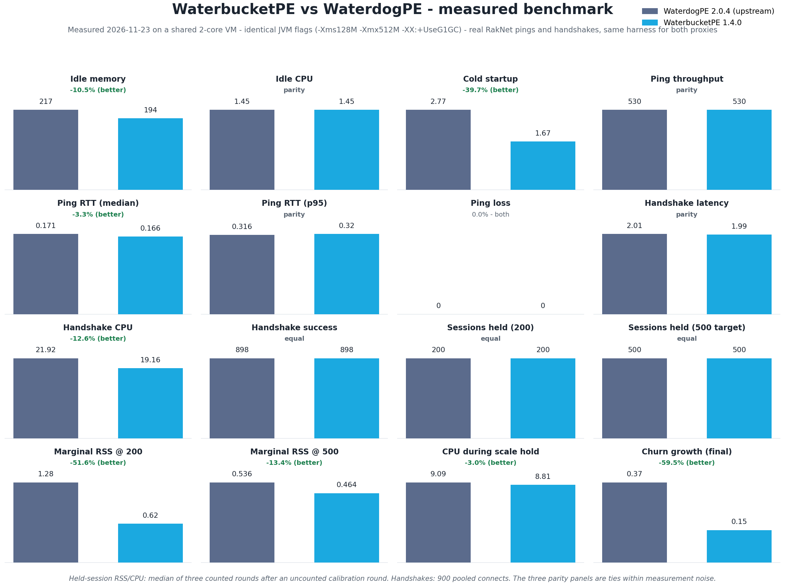

<h1 align="center">
  <picture>
    <source media="(prefers-color-scheme: dark)" srcset=".github/logo.png">
    
  </picture>
  <br>
  WaterbucketPE
</h1>

<p align="center">
  <strong>A fast, memory-efficient Minecraft: Bedrock Edition proxy</strong><br>
  Forked from the well-known <a href="https://github.com/WaterdogPE/WaterdogPE">WaterdogPE</a> proxy
</p>

<p align="center">
  <a href="https://github.com/AmirShafi6819/WaterbucketPE/releases"></a>
  <a href="LICENSE"></a>
  <a href="https://adoptium.net/"></a>
  <a href="https://www.minecraft.net/"></a>
  <a href="https://github.com/AmirShafi6819/WaterbucketPE/actions"></a>
  <a href="https://github.com/WaterdogPE/WaterdogPE"></a>
</p>

<p align="center">
  <a href="#about">About</a> ·
  <a href="#features">Features</a> ·
  <a href="#screenshots">Screenshots</a> ·
  <a href="#benchmark">Benchmark</a> ·
  <a href="#quick-start">Quick start</a> ·
  <a href="#plugins">Plugins</a> ·
  <a href="#documentation">Docs</a> ·
  <a href="#contributing">Contributing</a>
</p>

---

## About

WaterbucketPE is a drop-in replacement for WaterdogPE: same protocol behavior, the same
plugin API, and the same configuration format — with a rebuilt networking core, a built-in
web panel, an embedded **Python plugin runtime** next to the classic Java one, and hardening
against the real bug classes we could reproduce.

**Compatibility promise:** existing WaterdogPE jar plugins run unchanged. Configs, commands,
transfers, forwarding and the event API are preserved. The Python front-end is purely additive.

## Features

- **Stable proxy core** — cross-loop visibility fixes locked by contract tests, bounded
  queues, guarded transfer handoff, and failure containment at every layer.
- **Fast networking** — per-leg zlib compression levels, flush consolidation on both legs,
  right-sized event loops, adaptive packet-batch drain, and O(1) player lookups.
- **Web panel** — a token-secured dashboard served by the proxy itself: live charts, players,
  downstream servers with real pings, and a console that runs proxy commands.
- **Plugins in Java *and* Python** — the classic jar API is untouched; Python plugins are
  plain folders next to your jars, powered by GraalPy with zero configuration.
- **Efficient memory use** — release-mode leak detection off, right-sized caches, and no
  known leaks under connect/disconnect churn.
- **Actively maintained** — full regression suite (`./gradlew test`), CI on every push, and
  docker images published for every tagged release.

## Screenshots

| Dashboard | Players |
|---|---|
|  |  |
| **Servers** | **Console** |
|  |  |

## Benchmark

Measured comparison against upstream WaterdogPE — same 2-core VM, identical JVM flags,
real RakNet pings and handshakes, the same harness driving both proxies (2026-11-23).
Held-session memory/CPU figures are medians of three counted rounds after an uncounted
calibration round; the handshake figures pool 900 connects after a 120-connect JIT
warm-up — the same protocol for both proxies.

<p align="center">
  <picture>
    <source media="(prefers-color-scheme: dark)" srcset=".github/benchmark-comparison.png">
    
  </picture>
</p>

Highlights: idle memory −10.5% (216.6 → 193.8 MB), cold startup −39.7%, ping RTT median
−3.3%, handshake CPU −12.6%, marginal memory per held session −51.6% at 200 sessions and
−13.4% at 500, CPU during the 500-session hold −3.0%, churn growth −59.5%. All 200 and all
500 concurrent sessions held on both sides, 898/900 handshakes succeeded on both, zero ping
loss on both. The remaining panels (idle CPU, ping RTT p95, ping throughput) measured as
exact ties — shown as-is, nothing hidden; per-session RSS deltas are page-level and are
reported as medians of repeated rounds for that reason.

## Quick start

**Requirements:** Java 17+ (Temurin recommended). Players connect with any Bedrock client ≥
the latest supported game version.

```bash
# Linux / macOS
java -jar Waterbucket.jar
# or the provided script
./start.sh
```

```bat
:: Windows
start.bat
```

Download the latest jar from the
[Releases](https://github.com/AmirShafi6819/WaterbucketPE/releases) page, or build it from
source (below). The first start writes `configs/config.txt` (servers, priorities,
compression, panel), prints the web panel token location, and binds RakNet on port `19132`.
Point your Bedrock clients at the proxy and register downstream servers under `servers:`.

**Docker** — images are published to GitHub Container Registry for every tagged release:

```bash
docker run -d -p 19132:19132/udp -p 19132:19132/tcp \
  ghcr.io/amirshafi6819/waterbucketpe:latest
```

## Configuration highlights

| Option | Default | Purpose |
|---|---|---|
| `enable_panel` | `true` | serve the web dashboard from the proxy |
| `panel_bind_address` | `127.0.0.1` | keep loopback unless you front it with TLS |
| `panel_port` | `8080` | `0` picks a free port |
| `panel_token` | *(auto)* | API token; generated to `panel_token.txt` |
| `upstream_compression_level` | `6` | zlib level proxy → client |
| `downstream_compression_level` | `2` | zlib level proxy → servers |
| `prefer_fast_transfer` | `true` | intercept downstream `TransferPacket`s into fast transfers |

The full configuration lives in `configs/config.txt` with inline comments.

## Plugins

The classic jar API is untouched; Python plugins are plain folders next to your jars:

```yaml
# plugins/HelloPy/waterbucket.yml
name: HelloPy
main: main.py
```

```python
def on_enable(plugin):
    PlayerChatEvent = java.type("dev.waterbucket.waterbucketpe.event.defaults.PlayerChatEvent")
    plugin.subscribe(PlayerChatEvent, lambda event: logger.info(
        "{} says {}", event.getPlayer().getName(), event.getMessage()))
```

Full documentation for both languages, including a facade reference and troubleshooting,
is in [docs/PLUGINS.md](docs/PLUGINS.md) — with runnable examples under
[examples/plugins](examples/plugins).

## Documentation

- [Plugin API — Java & Python](docs/PLUGINS.md) · [نسخه فارسی](docs/PLUGINS.fa.md)
- [Changelog](CHANGELOG.md)
- [Compiling](COMPILING.md)
- [Contributing](CONTRIBUTING.md) · [Security policy](SECURITY.md)

## Building from source

```bash
./gradlew build          # tests + shaded jar in build/libs/Waterbucket.jar
./gradlew test           # full test suite
```

## Contributing

Issues and PRs are welcome — read [CONTRIBUTING.md](CONTRIBUTING.md) first.
Bug fixes need a regression test next to them; the transfer, event and player suites in
`src/test/java/dev/waterbucket/waterbucketpe/` show the patterns to copy.

## Acknowledgments

Built on [WaterdogPE](https://github.com/WaterdogPE/WaterdogPE) and the
CloudburstMC protocol stack. Flush-consolidation tuning follows
[Velocity](https://github.com/PaperMC/Velocity)'s published pipeline approach.
See [NOTICE](NOTICE) for attribution details.

## License

[GNU GPL v2](LICENSE) — inherited from upstream WaterdogPE.
