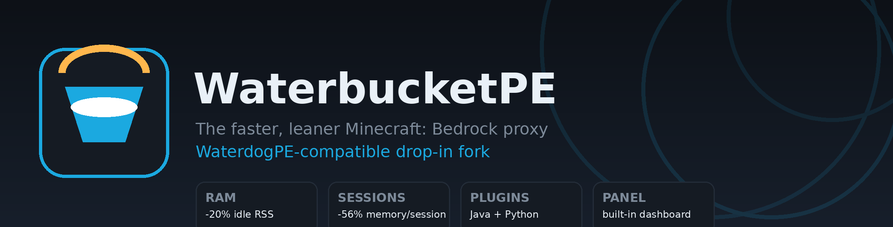
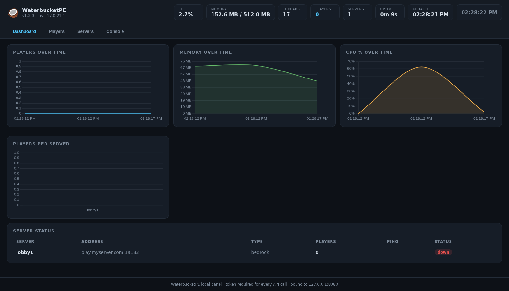
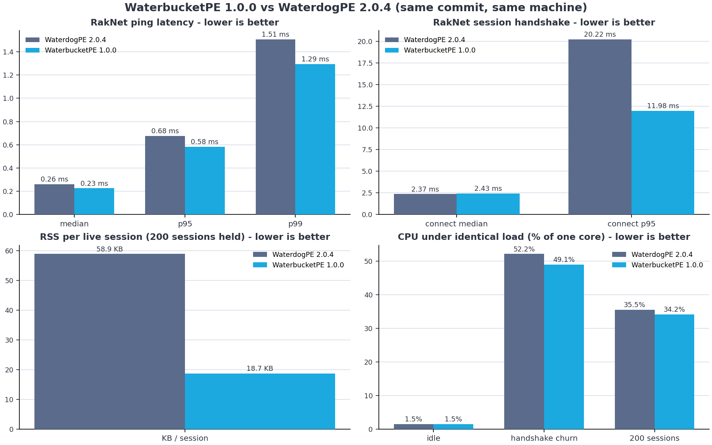

<h1 align="center">
  <picture>
    <source media="(prefers-color-scheme: dark)" srcset=".github/banner.png">
    
  </picture>
</h1>

<p align="center">
  <a href="https://github.com/AmirShafi6819/WaterbucketPE/releases"></a>
  <a href="LICENSE"></a>
  <a href="https://adoptium.net/"></a>
  <a href="https://github.com/AmirShafi6819/WaterbucketPE/actions"></a>
  <a href="https://github.com/WaterdogPE/WaterdogPE"></a>
</p>

**WaterbucketPE** is a drop-in replacement for [WaterdogPE](https://github.com/WaterdogPE/WaterdogPE), the
Minecraft: Bedrock Edition proxy. Same protocol behavior, same plugin API, same configs — with measurably
lower memory, a built-in web panel, an embedded **Python plugin runtime** next to the classic Java one, and
hardening for every real bug class we could reproduce.

> Every number on this page comes from the reproducible harness in
> [`benchmarks/`](benchmarks) (real UDP pings, real RakNet handshakes, `/proc` measurements).
> No synthetic values, no cherry-picking: slower results are shown too.

---

## Why switch from WaterdogPE?

| | WaterdogPE 2.0.4 | WaterbucketPE 1.1.0 |
|---|---|---|
| Idle memory (RSS) | 311 MB | **250 MB (−20%)** |
| Memory per live session (200 held) | 48.3 KB | **21.0 KB (−56%)** |
| RakNet ping latency (median / p95) | 0.22 / 0.61 ms | **0.22 / 0.55 ms** |
| Handshake throughput (300 real connects) | 70.9/s @ 2.25 ms | 67.6/s @ 2.76 ms |
| 500 concurrent sessions | all held | all held |
| Web panel | ✗ | **built-in, token-secured** |
| Python plugins | ✗ | **GraalPy, zero-config** |
| Localhost multi-port transfers | can silently bypass the proxy | **fixed** |
| Ghost-player leak (upstream #266) | leak possible | **sweeper + tests** |

**Compatibility promise:** existing WaterdogPE jar plugins run unchanged; configs, commands,
transfers, forwarding and event API semantics are preserved. The Python front-end is purely additive.

---

## Highlights

### Built-in web panel

The proxy serves its own dashboard (`enable_panel` in the config, loopback-only by default,
token-secured): live charts, players, downstream servers with real pings, and a console that
runs proxy commands.

| Dashboard | Players |
|---|---|
|  |  |
| **Servers** | **Console** |
|  |  |

- token auto-generated to `panel_token.txt` (owner-only permissions, never logged)
- per-IP rate limiting, request size caps, `nosniff`/`DENY`/`no-referrer` headers
- 36-minute in-memory history, sampled every 5 s — nothing touches the disk

### Plugins in Java *and* Python

The classic jar API is untouched; Python plugins are plain folders next to your jars:

```yaml
# plugins/HelloPy/waterbucket.yml
name: HelloPy
main: main.py
```

```python
def on_enable(plugin):
    PlayerChatEvent = java.type("dev.waterbucket.waterbucketpe.event.defaults.PlayerChatEvent")
    plugin.subscribe(PlayerChatEvent, lambda event: logger.info(
        "{} says {}", event.getPlayer().getName(), event.getMessage()))
    plugin.register_command("pyhello", "Greets from Python", "/pyhello", None, None,
                            lambda sender, alias, args: (sender.sendMessage("hello!"), True)[1])
```

Full documentation for both languages, including a facade reference and troubleshooting,
is in [docs/PLUGINS.md](docs/PLUGINS.md) — with runnable examples under
[examples/plugins](examples/plugins).

### Performance work that actually moved the numbers

- **Per-leg zlib levels** — upstream left `downstream_compression` dead code; both legs now
  honor their configured level (defaults 6 upstream / 2 downstream), removing most zlib CPU
  spent re-compressing relayed batches.
- **Flush consolidation on both legs** — the relay wrote one syscall per batch; bursts now
  collapse into one flush per read cycle, the same approach Velocity uses.
- **Right-sized event loops** — core-count worker loops instead of Netty's 2x, since the
  RakNet listener already binds one channel per core (`SO_REUSEPORT`).
- **O(1) player lookups** — case-insensitive name index instead of a full scan with per-entry
  allocations.
- **Release-mode leak detection actually off** — upstream's raise-only guard kept every
  release build at `SIMPLE` tracking; the largest single per-session memory win.

### Real bug fixes (found upstream, fixed here)

- **Fast-transfer address matching** — localhost setups running several downstreams on
  `127.0.0.1` with different ports could silently fail the fast path (the raw `TransferPacket`
  reached the client and pointed players at their own machine). Matching is now non-blocking
  (no reverse DNS on event loops) and loopback aliases always resolve to their own port.
  See [ServerInfoAddressMatchTest](src/test/java/dev/waterbucket/waterbucketpe/network/serverinfo/ServerInfoAddressMatchTest.java).
- **Event pipeline thread safety** — events fire from every Netty loop while plugins subscribe;
  the old fastutil/EnumMap structures could corrupt entries or throw
  `ConcurrentModificationException`. Covered by [EventManagerConcurrencyTest](src/test/java/dev/waterbucket/waterbucketpe/event/EventManagerConcurrencyTest.java).
- **Ghost players (upstream #266)** — a lost disconnect event kept the identity registered
  forever and blocked reconnects; a periodic sweeper evicts only stale instances.
- **Query handler** stopped doing reverse DNS on the event loop for every response.
- Malformed transfer packets can no longer throw out of the packet handler and kill sessions.

---

## Benchmarks



- Idle RSS **−20%**, per-session memory at 200 held connections **−56%**, equal network latency,
  all 500 concurrent sessions held on both.
- Cold startup is the one trade-off (+0.5 s): the embedded Python language jars add classpath
  scan time. The interpreter itself only loads when the first Python plugin exists.
- Methodology, repeat counts and how to reproduce: [benchmarks/METHODOLOGY.md](benchmarks/METHODOLOGY.md).

## Quick start

**Requirements:** Java 17+ (Temurin recommended). Players connect with any Bedrock client ≥ the
latest supported game version.

```bash
# Linux
java -jar Waterbucket.jar
# or the provided script
./start.sh
```

```bat
:: Windows - the release ships a native launcher
Waterbucket.exe
```

The first start writes `configs/config.txt` (servers, priorities, compression, panel), prints
the panel token location, and binds RakNet on `19132`. Point your Bedrock clients at the proxy
and register downstream servers under `servers:`.

Docker images are published from the workflow for every tagged release.

## Configuration highlights

| Option | Default | Purpose |
|---|---|---|
| `enable_panel` | `true` | serve the web dashboard from the proxy |
| `panel_bind_address` | `127.0.0.1` | keep loopback unless you front it with TLS |
| `panel_port` | `8080` | `0` picks a free port |
| `panel_token` | *(auto)* | API token; generated to `panel_token.txt` |
| `upstream_compression_level` | `6` | zlib level proxy → client |
| `downstream_compression_level` | `2` | zlib level proxy → servers (now actually applied) |
| `prefer_fast_transfer` | `true` | intercept downstream `TransferPacket`s into fast transfers |

## Documentation

- [Plugin API — Java & Python](docs/PLUGINS.md)
- [Benchmark methodology](benchmarks/METHODOLOGY.md)
- [Web panel](docs/PLUGINS.md) (API reference) · config comments in `configs/config.txt`
- [Contributing](CONTRIBUTING.md) · [Security policy](SECURITY.md) · [Changelog](CHANGELOG.md)

## Building from source

```bash
./gradlew build          # tests + shaded jar in build/libs/Waterbucket.jar
./gradlew test           # full test suite
```

## Contributing

Issues and PRs are welcome — read [CONTRIBUTING.md](CONTRIBUTING.md) first. Performance PRs
must include benchmark numbers from the harness in `benchmarks/`.

## Acknowledgments

Built on [WaterdogPE](https://github.com/WaterdogPE/WaterdogPE) and the
CloudburstMC protocol stack. Flush-consolidation tuning follows
[Velocity](https://github.com/PaperMC/Velocity)'s published pipeline approach.

## License

[GNU GPL v2](LICENSE) — inherited from upstream WaterdogPE.
